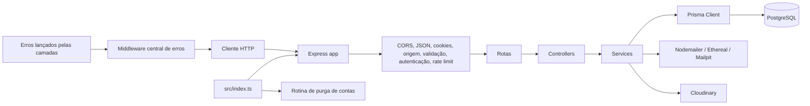
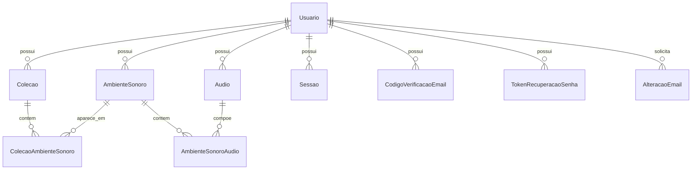

# Arquitetura da Sonessia API

Este documento descreve a arquitetura efetivamente encontrada no repositório em 31/10/2026. Ele separa implementação comprovada, suporte apenas persistido no esquema de banco e funcionalidades planejadas nas User Stories.

## 1. Visão geral

A Sonessia API é um backend HTTP em Node.js e TypeScript, organizado como uma API monolítica com Express. O ponto de entrada cria uma instância Express, aplica JSON, cookies e CORS, monta o router de autenticação em `/autenticacao` e encaminha erros para um tratador centralizado.

A persistência é feita em PostgreSQL por meio do Prisma ORM e de um único Prisma Client criado com o driver adapter PostgreSQL. A aplicação implementada atualmente cobre cadastro, verificação e recuperação de e-mail, login/sessões, alteração de dados, exclusão e reativação de conta e foto de perfil.

### Tecnologias confirmadas por uso no código

- Node.js e TypeScript, com ECMAScript Modules e NodeNext.
- Express 5 para HTTP.
- PostgreSQL acessado por Prisma 7.10, `@prisma/client` 7.10 e `@prisma/adapter-pg`.
- Zod para validação de ambiente e corpos de requisição.
- JWT HS256 para tokens de acesso; cookies HttpOnly, SameSite Lax para refresh tokens.
- Argon2id para senhas.
- Nodemailer com Ethereal e Mailpit; Ethereal/conta de teste é bloqueada em produção, assim como Mailpit.
- Cloudinary para armazenamento de fotos privadas de perfil.
- Cloudinary para armazenamento público de arquivos de áudio administrativos.
- `express-rate-limit` para limites específicos das rotas.
- Vitest, Supertest e um banco PostgreSQL de testes para testes automatizados.
- Prisma migrations e seed via scripts TypeScript.

Dependências presentes no manifesto que não representam módulos próprios da execução atual incluem utilitários do ecossistema e tipos; a arquitetura não cria, por exemplo, repositórios ou camadas extras além das encontradas em `src/`.

### Componentes principais



Os modelos `Audio`, `AmbienteSonoro`, `Colecao`, `ColecaoAmbienteSonoro` e `AmbienteSonoroAudio` são componentes persistenciais existentes, mas não possuem, no estado atual, services, controllers ou rotas que os exponham.

## 2. Estrutura de diretórios relevante

```text
.
├── src/
│   ├── app.ts                    # Configuração Express, CORS, rotas base e tratamento global
│   ├── index.ts                  # Inicialização do servidor e desligamento gracioso
│   ├── config/
│   │   ├── ambiente.ts           # Validação das variáveis de ambiente
│   │   └── cloudinary.ts         # Configuração central do SDK Cloudinary
│   ├── controllers/
│   │   ├── autenticacao.controller.ts
│   │   ├── audio.controller.ts
│   │   └── foto-perfil.controller.ts
│   ├── errors/app.error.ts       # Erro operacional tipado com status/código
│   ├── middlewares/
│   │   ├── autenticacao.middleware.ts
│   │   ├── autorizacao.middleware.ts
│   │   ├── erro.middleware.ts
│   │   ├── foto-perfil.middleware.ts
│   │   ├── origem.middleware.ts
│   │   ├── rate-limit.middleware.ts
│   │   └── validacao.middleware.ts
│   ├── routes/
│   │   ├── autenticacao.routes.ts
│   │   └── audios.routes.ts
│   ├── schemas/autenticacao.schema.ts
│   ├── services/
│   │   ├── audio.service.ts
│   │   ├── autenticacao.service.ts
│   │   ├── exclusao-conta.service.ts
│   │   └── foto-perfil.service.ts
│   ├── types/express.d.ts        # `Request.usuario`
│   └── utils/
│       ├── codigo.util.ts
│       ├── cookie.util.ts
│       ├── email.util.ts
│       ├── foto-perfil.util.ts
│       ├── jwt.util.ts
│       ├── senha.util.ts
│       └── token.util.ts
├── lib/prisma.ts                 # Instância compartilhada Prisma Client
├── prisma/
│   ├── schema.prisma
│   ├── seed.ts
│   └── migrations/
├── tests/
│   ├── *.test.ts                 # Testes Vitest/Supertest por funcionalidade
│   └── helpers/                  # Preparação e isolamento do banco de testes
├── prisma7.config.ts
├── tsconfig.json
├── vitest.config.ts
├── package.json
└── package-lock.json
```

A separação efetiva é predominantemente `routes → middlewares → controllers → services → Prisma`. A foto de perfil é apresentada por um controller próprio e seu middleware próprio, mas continua dentro do mesmo router de autenticação. Utilitários contendo integrações ou operações criptográficas são chamados pelos services.

## 3. Camadas, fluxo HTTP e exceções

### Responsabilidades das camadas

- **Routes:** declara métodos e caminhos e compõe os middlewares e handlers em `autenticacao.routes.ts`.
- **Middlewares:** validam corpo Zod, origem de mutações, autorização/autenticação, tamanho e tipo de imagem, e limites por IP em rotas específicas.
- **Controllers:** extraem dados da requisição, chamam services e escolhem status/resposta HTTP. Erros são repassados com `next(erro)`.
- **Services:** concentram regras de negócio, transações Prisma, emissão/verificação de códigos, atualização de sessões e integrações externas.
- **Prisma:** o acesso ao banco é centralizado no export de `lib/prisma.ts`, que usa `PrismaPg`.
- **Utils/config:** implementam operações transversais: JWT, cookies, Argon2id, tokens/códigos, e-mail, Cloudinary e ambiente.

### Fluxo de uma requisição

1. `src/index.ts` importa `app.ts`, inicia o listener e, quando o servidor sobe, inicia a rotina de purga de contas.
2. `app.ts` processa JSON, cookies e CORS; `/status` é pública.
3. `/autenticacao` delega ao router de autenticação.
4. O pipeline pode executar rate limit, validação de origem, validação Zod ou autenticação antes do controller.
5. O controller chama o service correspondente.
6. O service executa regras, transações Prisma e, quando aplicável, e-mail ou Cloudinary.
7. O Prisma Client utiliza a conexão PostgreSQL definida para o ambiente.
8. O controller envia JSON ou binário; exceções chegam ao middleware central, que produz o formato padronizado.

Exemplo de fluxo protegido:

```text
GET /autenticacao/eu
  → autenticar
  → usuario atual carregado do banco
  → fotoPerfil convertido em URL da própria API
  → Controller
  → JSON
```

### Erros

`AppError` carrega status HTTP, código estável, mensagem e detalhes opcionais. O middleware final trata:

- `AppError`: status e corpo definidos pelo lançamento.
- `ZodError`: HTTP `400`, código `DADOS_INVALIDOS` e uma lista com campo/mensagem.
- Prisma `P2002`: HTTP `409` e código de conflito.
- erros não tratados: HTTP `500`, código `ERRO_INTERNO`; em produção o log não revela a mensagem bruta.

Fallback de rota: HTTP `404`, código `ROTA_NAO_ENCONTRADA`.

### Exceções ao padrão

- Rotas simples como `/status` estão diretamente em `app.ts`.
- Upload de foto usa `express.raw` no middleware e binário no controller/service; não passa pelo schema Zod de JSON.
- `exigirPerfil` existe e é testado, mas não aparece na composição de nenhuma rota produtiva atual. Portanto, RBAC não está aplicado em endpoints públicos ou privados além da própria infraestrutura disponível.
- Há controllers e services separados para foto de perfil e exclusão de conta, mas continuam centralizados no router de autenticação.
- Não há rotas, controllers ou services reais para os modelos de catálogo/ambientes existentes.

## 4. Banco de dados

### Estratégia Prisma

O gerador `prisma-client` cria o cliente em `generated/prisma`. O datasource é PostgreSQL. A conexão é criada uma vez em `lib/prisma.ts`, com `PrismaPg`. Em modo de teste, a aplicação utiliza uma conexão PostgreSQL configurada para testes. Esse banco deve ser isolado dos ambientes de desenvolvimento compartilhado e de produção.

As migrações estão sob `prisma/migrations`, com `migration_lock.toml`. Os nomes mostram migrações SQL incrementais, aplicadas/gerenciadas pelo Prisma. Há um seed em `prisma/seed.ts`, não chamado por nenhuma rotina de aplicação além da configuração Prisma, e cria um usuário comum de teste somente quando `SEED_DEV_PASSWORD` está presente.

A migração inicial cria UUID para usuários? O Prisma atual confirma `Usuario.id` como UUID, mas a primeira migração usa `TEXT`; a migração seguinte altera a chave primária para UUID. Isso deve ser interpretado como evolução histórica comprovada; não há migração posterior de dados apresentada além das migrações existentes no diretório.

### Modelos atuais

#### Usuario e identidade

- UUID e perfil `COMUM | ADMIN`.
- E-mail único.
- Hash de senha, nome, data de nascimento, foto de perfil pública e public ID privado, verificação de e-mail e versão de credenciais.
- Campos de exclusão solicitada, definitiva, processamento e token de lease.
- Índice em `exclusaoDefinitivaEm`.

#### Autenticação e recuperação

- `CodigoVerificacaoEmail`: hash de código, tentativas, expiração, uso, relação cascata com usuário.
- `Sessao`: hash de refresh token, status `ATIVA | ROTACIONADA | ENCERRADA | REVOGADA`, substituição, expiração e índice por usuário; relação cascata.
- `TokenRecuperacaoSenha`: hash único, expiração, uso e relação cascata.
- `AlteracaoEmail`: estado dos tokens de confirmação do e-mail atual e novo, hash único, expiração, timestamps e índices.

#### Catálogo de áudio e organização — apenas persistência

- `Audio` pertence a `Usuario`, possui enum de categoria e metadados de licença/fonte/arquivo/título.
- `AmbienteSonoro` pertence a `Usuario`, possui enum de finalidade, metadados, imagem e data de criação.
- `Colecao` pertence a `Usuario` e contém nome e descrição.
- `ColecaoAmbienteSonoro` é associação muitos-para-muitos, com chave composta.
- `AmbienteSonoroAudio` associa ambiente e áudio, com chave composta e volume inteiro.

As relações de catálogo/coleções usam `ON DELETE RESTRICT`; os registros de autenticação usam exclusão em cascata em vários fluxos. Nenhum endpoint implementado consulta ou altera esses registros atualmente.

### Relações



## 5. Autenticação, sessões e segurança

### Cadastro e verificação

- Cadastro público em `POST /autenticacao/cadastro`.
- Validação Zod exige nome, e-mail, senha forte e data civil maior ou igual a 16 anos.
- Campos `fotoPerfil` e `fotoPerfilPublicId` são rejeitados no cadastro.
- Perfil é fixado pelo servidor como `COMUM`; perfil não é escolhido pelo cliente.
- As senhas são armazenadas com hash usando Argon2id, com parâmetros definidos na configuração de segurança da aplicação.
- Usuário é criado com e-mail não verificado; código numérico de seis dígitos é criado em uma transação com seu hash.
- E-mail de verificação é enviado fora da transação.
- Verificação usa bloqueio pessimista, expiração, limite de tentativas, comparação do hash e consumo condicional.

### Login, acesso e refresh

- Login é público e usa verificação Argon2id. Quando o usuário não existe, um hash Argon2id fictício é verificado para reduzir diferenças de tempo.
- Tokens de acesso JWT são emitidos com HS256, `iss`, `aud`, expiração configurada, `sub` e `versaoToken`.
- O acesso protegido lê o usuário atualizado do banco, não confia o perfil em claims e exige e-mail verificado e conta não marcada para exclusão definitiva.
- A versão do token é comparada à versão atual da conta.
- Refresh token opaco é armazenado como hash SHA-256, colocado em cookie HttpOnly, Secure em produção, SameSite Lax e path `/autenticacao`.
- `POST /autenticacao/renovar-sessao` faz rotação em transação. Sessões rotacionadas/revogadas podem ativar revogação das demais sessões em caso de reutilização detectada.
- Logout aceita opcionalmente um token de acesso, combina-o com o cookie e invalida/encerra a sessão correspondente.

### Endpoints protegidos

Protegidos por `autenticar` atualmente:

- `GET /autenticacao/eu`.
- `GET/PUT/DELETE /autenticacao/eu/foto-perfil`.
- `DELETE /autenticacao/eu`.
- `PATCH /autenticacao/eu`.
- `PATCH /autenticacao/eu/data-nascimento`.
- Solicitação e confirmação de alteração de e-mail.

Públicos ou sem autenticação obrigatória na implementação atual:

- cadastro, verificação, reenvio, login, renovação, logout, recuperação, redefinição, reativação;
- `/status`.

A alteração de nome/data não possui rate limit próprio no router, embora tenha validação/autenticação. Não há endpoints de negócio administrativo ou catálogo protegidos por `exigirPerfil`; o middleware RBAC está implementado e coberto por testes unitários/integrados, mas não usado em rotas produtivas.

### Foto de perfil e exclusão

O upload lê até 5 MiB, valida Content-Encoding, tipo declarado e assinatura/dimensões de JPEG, PNG ou WebP, e envia a imagem privada para Cloudinary. A URL interna `/autenticacao/eu/foto-perfil` é usada nas respostas; o public ID não é exposto. Remoções remotas podem ficar pendentes e são tratadas como resultado assíncrono/coordenado pelo service.

A solicitação de exclusão exige a senha atual e restringe o fluxo a usuários comuns. A conta fica em estado de pendência por 30 dias; durante esse período, aplicam-se os controles de sessão e as regras de reativação. A exclusão definitiva é processada por uma rotina interna com mecanismos de coordenação para evitar processamento concorrente. A reativação verifica as credenciais sem revelar a elegibilidade da conta por meio de mensagens específicas.

## 6. Validação, respostas e erros

### Zod

Os schemas estão concentrados em `src/schemas/autenticacao.schema.ts`. `validarCorpo` chama `parseAsync`, substitui `req.body` pelos dados validados e normalizados, e encaminha `ZodError` ao tratador global. Objetos são estritos nos schemas sensíveis de alteração com `.strict()`.

Há validações adicionais em:

- ambiente de execução via `config/ambiente.ts`;
- Cloudinary/configuração opcional e obrigatória em produção;
- formato do arquivo de foto no middleware/service;
- conteúdo dos tokens/códigos nas próprias rotas e utils.

### Contratos de resposta

Respostas de sucesso usam JSON composto por `mensagem`, `usuario`, tokens ou campos específicos da operação. A foto é uma exceção que usa corpo binário com headers privados. Erros seguem:

```json
{
  "erro": {
    "codigo": "CODIGO_ESTAVEL",
    "mensagem": "Descrição segura.",
    "detalhes": []
  }
}
```

Dados inválidos produzem itens como `{ "campo": "...", "mensagem": "..." }`. Responses conhecidas incluem `401`, `403`, `404`, `409`, `429` e `502` para falhas de integrações conforme o service; falhas inesperadas são `500`.

O fallback global para rota inexistente usa o mesmo objeto, mas não usa `next`.

## 7. E-mail, Cloudinary, testes e configuração

### E-mail

`src/utils/email.util.ts` suporta:

- verificação de e-mail;
- recuperação de senha;
- confirmação do e-mail atual/novo.

Com Nodemailer, Ethereal é usado fora da produção e cria uma conta de teste. Mailpit é configurado como transporte SMTP local. Ambos os provedores são explicitamente impedidos em produção. Em testes, os envios são simulados por padrão, com interceptadores disponíveis; forçar Ethereal em testes exige configuração explícita.

### Cloudinary
Cloudinary é usado pelos fluxos de foto de perfil e de áudio. A foto usa recurso privado do tipo `image`; os áudios usam recurso público do tipo `video`, pois o SDK Cloudinary classifica arquivos de áudio nesse tipo. O SDK é inicializado automaticamente se todas as credenciais estiverem presentes. Em produção, todas são exigidas; fora dela, podem estar ausentes. A operação falha com `AppError` seguro se o serviço não estiver configurado.

### Configuração e execução

Os scripts efetivos são:

- `npm run dev`: `tsx src/index.ts`;
- `npm test`: Vitest uma vez;
- `npm run typecheck`: `tsc --noEmit`;
- `npm run prisma:status`: status das migrations com `prisma7.config.ts`;
- `npm run prisma:generate`: geração do cliente Prisma;
- `npm run seed`: seed de desenvolvimento.

Vitest inclui `tests/**/*.test.ts`, com ambiente Node. Há testes para cadastro/login, verificação, renovação, recuperação, alteração de e-mail, perfil, foto, exclusão, autorização, CORS, ambiente, Cloudinary e banco de testes.

Os testes de integração dependem de um PostgreSQL específico para testes ou da derivação/configuração descrita em `prisma7.config.ts` e `lib/prisma.ts`. Os helpers podem verificar/criar `sonessia_test`, mas não fazem parte da execução da API HTTP.

## 8. Mapeamento das User Stories

### Implementado ou suportado por implementação/testes

| Scope/User Story                                                   | Evidência atual                                                  | Estado arquitetural                                                            |
| ------------------------------------------------------------------ | ---------------------------------------------------------------- | ------------------------------------------------------------------------------ |
| US05 — cadastro, perfil após autenticação                          | `cadastro`, `login`, `/eu`, services e testes de cadastro/perfil | **Implementado; perfil pessoal implementado apenas para dados básicos e foto** |
| Conta e autenticação                                               | JWT, refresh cookie, sessões, verificação e recuperação          | **Implementado; coberto por múltiplos testes**                                 |
| Gestão do usuário                                                  | nome, nascimento, e-mail, exclusão/reactivação                   | **Implementado**                                                               |
| Foto de perfil (complemento não listado no mesmo detalhe em TASKS) | rotas, middleware, service e Cloudinary                          | **Implementado**, condicionado à configuração Cloudinary                       |

A existência e quantidade dos testes indicam maior certeza do que os boxes de `TASKS.md`, mas o arquivo exige confirmação independente de subtarefas específicas. Não há evidência de que toda possibilidade descrita tenha sido coberta pela suite; o estado abaixo é factual sobre código.

### Parcialmente implementado

| User Story                              | O que existe                                                         | Falta                                                                                                       |
| --------------------------------------- | -------------------------------------------------------------------- | ----------------------------------------------------------------------------------------------------------- |
| US01 — Áudios do catálogo               | Prisma `Audio`, enum de categoria e relação com usuário              | Rotas, validação, controller, service e autorização administrativa; estados de ativo/disponível não existem |
| US02/US08 — Ambientes pré-configurados  | Modelos de ambiente, finalidade, áudio-composição e volumes          | Publicação/estado, endpoints públicos, filtros por finalidade, serviços e testes; `finalidade` é enum fixo  |
| US03 — Catálogo público                 | `Audio` possui metadados/categoria                                   | Rotas públicas, filtros ativos, DTO e validação de disponibilidade                                          |
| US04 — Composição temporária/reprodução | Relação ambiente-áudio com volume; modelo de persistência            | Contrato de composição temporária, validação de disponibilidade, URLs/negócio e endpoints                   |
| US05 — Ambientes personalizados         | Modelos `AmbienteSonoro` e associação com usuário                    | Rotas de salvar/listar/consultar, ownership, validação e testes de isolamento                               |
| US06 — Coleções                         | Modelos `Colecao` e associação com ambientes                         | Rotas e services para CRUD/associação; isolamento de usuário; testes                                        |
| US14 — Recursos públicos                | `/status` e infraestrutura de autenticação/rotas públicas protegidas | Catálogo público, composição pública e ambientes públicos ainda inexistentes                                |

A parte de cadastro, perfil e proteção pessoal da US14 está suportada. Não se deve considerar a parte de catálogo/armazenamento implementada porque só os modelos persistentes existem.

### Ainda não implementado

US07 (temporizador), US09 (tema persistido), US13 (compartilhamento) não possuem módulos ou modelos próprios encontrados. Decidir se são responsabilidade do backend é necessário antes de criar arquitetura para eles.

US10–US12 estão Won’t Have conforme `TASKS.md` e não integram este documento como requisitos futuros.

A divisão de responsabilidade da reprodução permanece pendente: não há player, contrato de composição temporária ou implementação de controle de playback na API.

## 9. Lacunas, decisões pendentes e evolução

### Lacunas observadas no código

- Não há um módulo de catálogo além dos modelos Prisma.
- Não há um campo comprovado de publicação, disponibilidade, ativação ou remoção em áudio/ambiente. Os enums existem, mas não cobrem estado publicável.
- Não há schemas Zod, rotas, controllers ou services para áudio, ambiente, finalidade, composição ou coleção.
- Não há uso produtivo de `exigirPerfil`; administrar catálogo/ambientes ainda não tem segurança implementada.
- Não há contrato de DTO para os dados sonoros nem fonte/URL de reprodução pública.
- Os modelos Prisma não são suficientes para garantir isolamento de usuário: as regras precisam existir nas consultas e controllers/services futuros.
- Não há testes para recursos US01–US09, US13 ou US14 além dos já existentes de usuário/autenticação.

### Decisões pendentes a confirmar

1. Ambiente pré-configurado deve permitir finalidade fixa (`enum Finalidade`) ou finalidade administrável em tabela?
2. Categorias de áudio devem ser listas fixas ou entidades gerenciadas?
3. Remoção de áudio deve ser física ou lógica, e qual campo representará ativo/desativado?
4. Ambientes publicados precisam de um estado de publicação e, se aplicável, campo de disponibilidade.
5. A API só fornece metadados/URLs ou também coordenará reprodução? A USER STORY pede confirmação da divisão entre frontend/player e backend.
6. Composições temporárias devem ser representadas por DTO e validação de IDs existentes ou por payload completo com fontes/volumes.
7. Temporizador pertence ao frontend, à API com persistência ou a uma combinação sem persistência?
8. Preferência de tema pertence ao frontend ou requer persistência de usuário na API?
9. Compartilhamento público deve usar link, expiração, revogação ou acesso autenticado, além das regras após edição/exclusão do ambiente.
10. Composições anônimas devem sobreviver a refresh da página/dispositivo ou estar apenas na memória do cliente.

### Onde novas funcionalidades poderiam se encaixar — somente como recomendação

Como inferência arquitetural, categorias, áudio e ambientes devem seguir os módulos existentes: `routes → controllers → services → lib/prisma`, com schemas Zod e middlewares de autenticação/autorização. Coleções e ambientes personalizados pertencem à mesma separação, e todas as consultas privadas devem filtrar pelo `req.usuario.id`. Dados de áudio/ambientes públicos podem ser adicionados a um novo router público, mas nenhum desses arquivos/módulos existe hoje.

Essas são sugestões de evolução; não representam funcionalidade já implementada.
